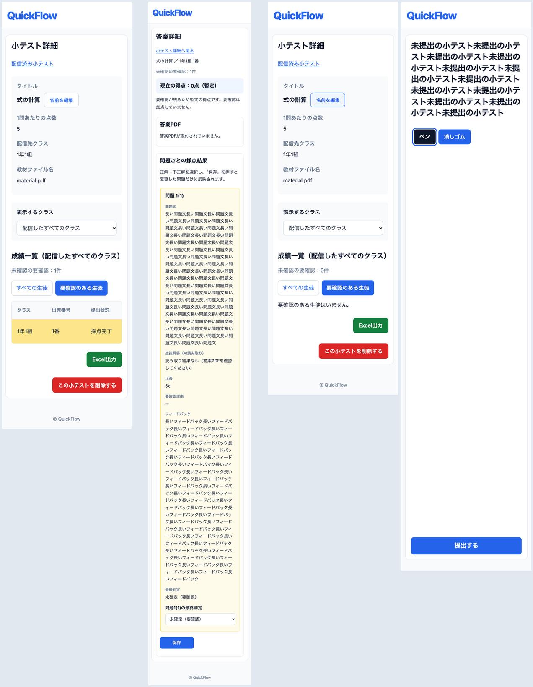

# QuickFlow

中学校数学の「式の計算」の小テストを、PDF配信から手書き解答・採点・成績出力まで支援するRailsアプリです。教師の採点・転記負担と、生徒への返却の遅れを減らすことを目指します。普段のPDF教材を使い、AIの判定と教師の最終判定を分け、判読が難しい答案を「要確認」として残す点が特徴です。



画像は[Issue #95の実Chrome監査](docs/implementation/issue95_screen_audit.md)で撮影した架空データです。長文・空状態の試験を含み、AIの実行結果や本番画面ではありません。現行ビューと導線を照合して再利用しています。

## 現在の実装と検証範囲

コードの照合基準は [main@9704b30](https://github.com/arduino0420/quickflow/commit/9704b30fa90867a359d11a8ccf0cff78520aa5d2)（2026-10-23）。親タスク確認の[main CI39876600200](https://github.com/arduino0420/quickflow/actions/runs/39876600200)は4ジョブ成功、全RSpec 2,034件・失敗0件です。本ドキュメント最終headのCIは別途確認します。[必須39項目と証拠](docs/implementation/issue103_submission_evidence.md)は実装・試験と、配備・本人の提出・学校受入を分けて記録しています。これは公開動作や卒業合格の証明ではありません。

ゲストの技術実装は完了していますが、**外部公開は未実施**です。[2026-10-22の限定公開観測](docs/implementation/issue51_predeployment_runbook.md)ではroot404、3ログインと/upが200、TLS検証成功でした。CookieにSecureがなくHSTSも観測されていません。PR127のコード修正はmerge済みですが、配備と公開応答での修正確認は未実施。現在の稼働commit/image・DB・storage mountは未検証です。EC2/Caddyによる既存環境と、未配備のmain・独立デモprofileを同一視しません。[本番確認 #99](https://github.com/arduino0420/quickflow/issues/99)・[運用監査 #51](https://github.com/arduino0420/quickflow/issues/51)で提出用URL、HTTPS、`/up`、ログイン画面、DB/PDFのバックアップと復元、ワーカー監視の実証が必要です。`/up`はRails起動確認であり、AI・DB・キュー全体の健全性を保証しません。

## ロール別の利用方法

| ロール・入口 | 主な操作 |
| --- | --- |
| 教師 `/login` | 教師IDとパスワードでログイン。PDF・点数・配信先クラスを登録し、成績一覧→答案詳細でAI判定を確認/修正。得点は再計算され、単一/全配信クラスのExcelを出力。小テスト名変更・所有する小テスト削除、担当クラスの生徒登録も可能 |
| 生徒 `/student/login` | 学校コード・学年・クラス・出席番号・パスワードでログイン。未提出小テスト→PDFへ手書き→自動保存→「提出する」→採点結果を確認。通常の選択肢は1〜3年・1〜10組・1〜40番 |
| 管理者 `/admin/login` | 管理者IDとパスワードでログイン。自校の教師登録/担当・パスワード変更、生徒一覧/登録/所属編集/パスワード再設定/条件付き削除。重要な生徒操作は確認と管理者再認証が必要 |

公開サインアップはありません。教師/管理者の初期登録は所属と権限を確認した運用担当者が行います。学校コードだけで所属を証明できません。管理者15文字以上、教師は英字と数字を含む半角英数字10文字以上（各72バイト以下）、生徒は半角数字8桁で、弱い反復・語句/連番を拒否します。登録入口/運用タスクとパスワード変更で適用し、既存パスワードの一括変更はしません。パスワード変更後の旧セッションは次の認証確認で失効します。[登録・移行・削除の詳細と安全手順](docs/implementation/operations_details.md)を参照してください。

PDFは複数ページ・黒ペン/消しゴムに対応し、下書きは再ログイン後も復元します。自動保存だけでは正式提出になりません。未保存の筆跡は通信断のまま画面を閉じると失われる場合があります。従来PDFアップロードも詳細画面に残ります。答案PDFは25MiB、提出HTTP本文は32MiBまでです。

AIは「正解・不正解・要確認」を保存し、教師が修正できます。要確認は得点に加算せず、技術的失敗は採点完了と区別します。教師の採点再開ボタンは既定OFFで、世代・PDF・保存結果・未完了Jobを確認する運用条件があります。[採点・復旧・外部ファイル保持の詳細](docs/implementation/operations_details.md)を確認してください。#47永続要求台帳・#46短いclaim・#48 qpdf・#49成績取得集約はコードに統合済みですが、本番反映の証拠ではありません。

### 初めて使う方へ（架空データでの説明）

冒頭の[3画面画像](docs/implementation/issue95-evidence/flow-390.jpg)は既存の架空データのChrome検証です。実学校・実本番のスクリーンショットではありません。

1. 教師はログイン後、PDF教材・1問の点数・配信先を確認して配信します。正答生成は非同期です。結果を待つ間に再配信すると別課題になるため、連打せず状態を確認します。
2. 生徒は配信された小テストを開き、PDFに黒ペンで書き込みます。保存状態を確認し、「提出する」で正式提出します。自動保存は提出とは別です。通信断で未保存なら画面を閉じず、復旧後の保存状態を確認します。
3. 教師は成績一覧から答案を開き、AIの「要確認」や誤判定を教師判定で修正します。生徒は結果を確認し、教師は配信クラスを確認してExcelを出力します。AIは正確性の保証や教師判断の代替ではありません。
4. 管理者は自校の教師・生徒を管理します。所属変更/削除/パスワード再設定では確認画面と対象を確かめます。通常利用者へ管理操作を渡しません。

PDF拒否や503では案内を読み、別のPDFを無闇に再送しません。暗号化PDFの手書きexportは未対応です。採点失敗/停止は教師から運用担当者へ連絡し、PDF/既存結果を保持します。経過時間だけで停止を断定せず、再実行・queue削除をしません。[詳細運用・外部AI保持の制限](docs/implementation/operations_details.md)と[配備前runbook](docs/implementation/issue51_predeployment_runbook.md)を参照してください。実学校導入時は権限・データ取扱い・backup/監視・利用者説明と受入を別途確認します。

### 作品説明の短い話順（#105・任意資料）

- **課題と価値**：PDF教材を起点に、配布・採点・転記と返却待ちを減らす構想。実際の削減時間や学校導入効果は未測定です。
- **3画面で説明**：上記架空画像で、生徒の手書き/保存→AIの補助判定→教師修正/Excelを示します。通常のPDF教材、曖昧な筆跡の要確認、教師の最終判断という設計を説明し、他ICTより優れるという未検証の比較はしません。
- **技術の理由**：Rails/PostgreSQLで学校・配信・答案の関係と認可、PDF.js/pdf-libで手書き、OpenAIで読取/判定支援、Solid Queueで非同期、caxlsxでExcel、Docker/CIで配備物と回帰試験を扱います。AWS EC2は既存運用方針であり最新コードの稼働確認は保留です。
- **信頼性と限界**：durable台帳とfenced claim、qpdf境界、学校間認可、教師判定保持を既存コード/テストから説明します。AI誤判定、料金/送信データ、通信断の未保存筆跡、暗号化PDF、公開デモ未配備・実端末未確認を隠しません。
- **残る作業**：実環境配備承認、復元実証、公開HTTPS/Cookie/job確認、人間の設計再投稿/通知/提出、学校受入。利用者ヒアリングは未実施で、行うなら同意と匿名化が必要です。

これは既存画像と資料を使う簡潔な話順であり、公開デモの実演や独立スライド完成とは称しません。#105の任意資料は必須39項目の完了判定と分けます。別タスクの合成QA画像は受領待ちで、発表成果物の受入も未確認のため#105完全完了とはしていません。

### 閲覧専用ゲスト

対応する隔離デモで入口を有効にすると、ホームの管理者/教師/生徒ゲストボタンから開始できます（`POST /guest/:role`、通常環境はOFF）。15分で期限切れとなり、切替/ログアウトで旧cookieを失効します。架空の登録済みデータだけを閲覧し、教師は成績/Excel/答案、生徒は自分の課題/教材/結果、管理者は自校一覧を確認できます。登録・編集・削除・手書き提出・AI呼出し・Job実行は許可しません。手書きや実AIを体験できる公開デモという案内ではありません。

[初期test profileの履歴](docs/implementation/issue93_read_only_guest.md)と[production-mode profile・公開前条件](docs/implementation/issue93_production_demo.md)を参照してください。testサーバーをインターネットへ公開しないでください。実公開のDNS/TLS、OSによる読み取り専用mount、proxy/egress制御、公開Chromeの確認は未実施です。12業務表と正規添付の初期データ検証と、全物理表に5行あるという主張は異なります。

## 技術構成

Ruby **4.0.6**（`.ruby-version`）、Rails **8.1.4**（`Gemfile.lock`）、PostgreSQL（開発基準18.6）、Puma、Active Record/Active Storage、Hotwire/Importmap、PDF.js/pdf-lib、OpenAI SDK、caxlsx、Solid Queue/Cache/Cableを使用します。DockerfileとKamal設定、GitHub Actions CIがあります。AWS EC2/Caddyは既存配備側の構成であり、リポジトリのKamal設定をそのまま実稼働設定とは扱いません。公開設定の確定・確認は#51/#99の範囲です。

PDFの読み取り事前確認にはqpdf 12.4.2を使用します。ローカル起動・テストの前に`bin/install-qpdf`を実行してください（curl/unzipが必要）。公式配布物のSHA-256を確認して`vendor/qpdf`内だけに配置し、Docker/CIにも組み込みます。[受入仕様・実行上限・暗号化PDFの制約](docs/implementation/operations_details.md#pdf読み取り事前確認issue-48)を参照してください。

## ローカル起動とテスト

Ruby 4.0.6、Bundler、PostgreSQLと開発ヘッダー、libvipsを用意します。System SpecにはChrome/Chromiumと対応Selenium driver（Selenium Manager利用時は取得可能なネットワーク）が必要です。既存DBと共有しない新しいclone・専用DB/Storageを使ってください。通常の開発は`storage/`、テストはclone内`tmp/storage/`です。

```bash
git clone https://github.com/arduino0420/quickflow.git
cd quickflow
bundle install
bin/install-qpdf
export RAILS_ENV=development
export DATABASE_URL=postgresql://127.0.0.1:5432/quickflow_local_development
# 専用DB名・接続先であることを確認してから作成
bin/rails db:create
bin/rails runner 'c = ActiveRecord::Base.connection; puts [Rails.env, c.select_value("SELECT current_database()"), c.select_value("SELECT inet_server_addr()"), c.select_value("SELECT inet_server_port()")].inspect'
# 上の実接続が意図した専用DBの場合のみ
bin/rails db:migrate
bin/rails server -b 127.0.0.1
```

`http://127.0.0.1:3000`へアクセスします。接続URLは自身の専用DBに合わせ、パスワードを履歴やリポジトリに残さないでください。`PRIMARY_DATABASE_URL`等の接続上書きが設定されている場合は取り除くか同じ専用接続先に揃え、Railsの実接続を確認します。新規DBは空です。通常の`db:seed`はコメントのみでデモ/初期アカウントを作りません。**既存DBにreset/drop/demo seedを実行しないでください。** 架空デモは[専用の新規クラスタを使う手順](docs/implementation/issue92_safe_demo_seed.md)だけで作成します。

通常の開発で実AIを利用する場合のみ、運用者から自分の環境用の秘密値を安全に受け取り、`bin/rails credentials:edit`で`openai.api_key`へ保存します。復号には対応する`RAILS_MASTER_KEY`または非公開のmaster keyが必要です。値をREADME・Issue・ログに貼らないでください。`OPENAI_MODEL`、`OPENAI_ANSWER_READING_MODEL`、`OPENAI_QUESTION_GENERATION_MODEL`、`OPENAI_ANSWER_GRADING_MODEL`と`OPENAI_TIMEOUT_SECONDS`が任意設定です。既定モデル名はソース上`gpt-6-astra`、待ち時間120秒で、利用可否・料金の保証ではありません。実送信・課金を伴う確認は別途承認が必要です。通常productionの`QUICKFLOW_DATABASE_PASSWORD`やdemo専用秘密値は[profile手順](docs/implementation/issue93_production_demo.md)に従って管理し、開発/テストへ持ち込みません。

全件/requestsテストにはDB名`quickflow_test`を要求する安全ガードがあります。名前を変えたりガードを外したりせず、**毎回新しい専用PostgreSQLクラスタ**を作り、既存の`quickflow_test`とは物理的に隔離します。PostgreSQL 18の`pg_config`・`initdb`・`pg_ctl`・`createdb`がPATHから使えることを確認し、demo/load専用環境変数や本番秘密値を引き継がない専用ターミナルで、次のブロック全体を実行します。通常の開発サーバーとテストを同じcloneで同時に動かさないでください。

```bash
(
set -eu
export RAILS_ENV=test
unset QUICKFLOW_DEMO_PROFILE QUICKFLOW_GUEST_LOGIN QUICKFLOW_HTTP_LOAD_RUN_ID SOLID_QUEUE_IN_PUMA
QF_PG_BIN="$(pg_config --bindir)"
export QF_TEST_ROOT="$(mktemp -d /tmp/qf-test.XXXXXX)"
export QF_TEST_PORT=57519
mkdir "$QF_TEST_ROOT/socket"
# 失敗時も今回作ったクラスタだけを停止。失敗後にschema準備へ進まない
trap 'if test -f "$QF_TEST_ROOT/data/postmaster.pid"; then "$QF_PG_BIN/pg_ctl" -D "$QF_TEST_ROOT/data" -m fast -w stop; fi' EXIT
"$QF_PG_BIN/initdb" -D "$QF_TEST_ROOT/data" -U qf_test_owner --locale=C --encoding=UTF8 --auth-local=trust --auth-host=trust
# ポート使用中なら起動は失敗する。既存サービスを停止せず、別の未使用ポートで新規クラスタを作る
"$QF_PG_BIN/pg_ctl" -D "$QF_TEST_ROOT/data" -l "$QF_TEST_ROOT/postgres.log" \
  -o "-h 127.0.0.1 -p $QF_TEST_PORT -k $QF_TEST_ROOT/socket" -w start
unset PGHOSTADDR PGSERVICE PGSERVICEFILE PGOPTIONS PGPASSWORD
export PGHOST=127.0.0.1 PGPORT="$QF_TEST_PORT" PGUSER=qf_test_owner
export DATABASE_URL="postgresql://qf_test_owner@127.0.0.1:$QF_TEST_PORT/quickflow_test"
export PRIMARY_DATABASE_URL="$DATABASE_URL"
"$QF_PG_BIN/createdb" quickflow_test
# schema準備前にRailsの設定と実SQL接続、クラスタの実ディレクトリを照合。不一致なら終了する
bin/rails runner '
  c = ActiveRecord::Base.connection
  cfg = ActiveRecord::Base.connection_db_config.configuration_hash
  actual = [c.select_value("SELECT current_database()"), c.select_value("SELECT inet_server_addr()"),
    c.select_value("SELECT inet_server_port()").to_i, File.realpath(c.select_value("SHOW data_directory"))]
  expected = ["quickflow_test", "127.0.0.1", Integer(ENV.fetch("QF_TEST_PORT")), File.realpath(File.join(ENV.fetch("QF_TEST_ROOT"), "data"))]
  abort "Wrong test target" unless Rails.env.test? && cfg[:database] == expected[0] &&
    cfg[:host] == expected[1] && cfg[:port].to_i == expected[2] && actual == expected
  puts actual.inspect
'
# 上の照合が成功した場合だけ続行。この新規専用DBのschemaを準備する
bin/rails db:test:prepare
bundle exec rspec
# requests/modelsだけを確認する場合も同じ隔離環境で実行する
# bundle exec rspec spec/models spec/requests
bin/rubocop
bin/brakeman --no-pager
bin/bundler-audit
bin/importmap audit
# 完了後はこのターミナルで作った専用クラスタだけを停止する
"$QF_PG_BIN/pg_ctl" -D "$QF_TEST_ROOT/data" -m fast -w stop
)
```

コマンドが失敗したらその先を実行せず、接続先を再確認してください。上のtrust認証は架空データだけの一時的なloopback/専用ソケット用です。実データを入れたり公開アドレスへbindしたりしません。`db:test:prepare`やRSpecは対象DBを書き換えます。`db:drop`/`db:reset`/`demo:seed`で既存DBを掃除・再利用する手順ではありません。クラスタの停止先は記録した`QF_TEST_ROOT/data`だけとし、既存サービスや他タスクのクラスタを停止しないでください。

RSpecでは実OpenAIクライアントを禁止し、stubを使用します。実APIキーは不要です。demo/load専用の`QUICKFLOW_DEMO_*`、`QUICKFLOW_GUEST_LOGIN`、`QUICKFLOW_HTTP_LOAD_RUN_ID`等を通常テストに引き継がないでください。CIの実行コマンドとOS依存パッケージは[workflow](.github/workflows/ci.yml)が基準です。モデル/リクエストだけなら`bundle exec rspec spec/models spec/requests`でも実行できます。

## データ保護・運用と設計資料

DBと添付PDFは別々に保存されるため、整合したバックアップ・復元確認が必要です。公開環境の保存期間・復元手順の確定は#51で保留しています。小テストのDB削除と物理PDFの非同期削除、外部OpenAIの3600秒File期限/非同期cleanupは別のライフサイクルです。404だけでは外部削除済みを保証せず、`store: false`も保持ゼロを保証しません。[監視・個別再確認・安全な復旧手順](docs/implementation/operations_details.md)を省略せず参照してください。

- [チェックシート](https://docs.google.com/spreadsheets/d/1G-4Q3SS79nOKc3IJGaaYNftkwM0XktCnIgPAiMZ-1ug/edit#gid=1475280975) / [カタログ](https://docs.google.com/spreadsheets/d/1G-4Q3SS79nOKc3IJGaaYNftkwM0XktCnIgPAiMZ-1ug/edit#gid=0) / [テーブル定義](https://docs.google.com/spreadsheets/d/1G-4Q3SS79nOKc3IJGaaYNftkwM0XktCnIgPAiMZ-1ug/edit#gid=524149616)
- [ワイヤーフレーム](https://whimsical.com/Lj1FAP2VsasTMNMjFAfDb4) / [ER図](docs/er_diagram.png) / [画面遷移図](docs/screen_transition.png)
- [図の編集元・実装照合・全カラムと制約](docs/design/README.md)
- [画面・架空スクリーンショット監査](docs/implementation/issue95_screen_audit.md) / [Model Spec監査](docs/implementation/issue98_model_spec_audit.md) / [認証System監査](docs/implementation/issue96_authentication_system_audit.md) / [CRUD System監査](docs/implementation/issue97_crud_system_audit.md)
- [推奨品質監査 #104](docs/implementation/issue104_quality_audit.md) / [Phase F当時のREADME記録](docs/implementation/readme_history.md)

[PR124](https://github.com/arduino0420/quickflow/pull/124)の図をmain02a8237から統合済みです。親タスクで外部設計Sheetはコード9704b30へ同期、Macで更新範囲の可読性とWhimsical17フレームを確認し、WBSのmilestoneも更新済みです。[差分説明と通知用本文案](docs/implementation/issue103_submission_evidence.md)を用意しました。本人によるDPro再投稿・変更通知・最終提出は未完了です。Windows/Chromebook実機、実通信断、実答案サイズ分布、実AIの数学的正確性、公開環境での主要フロー確認は別途必要です。
