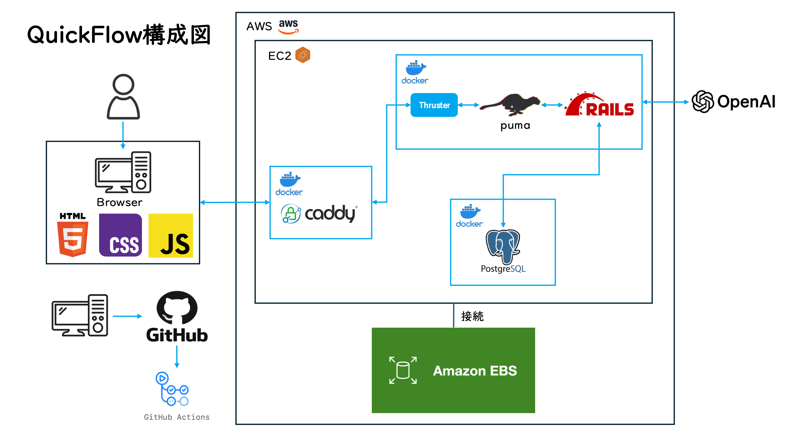

# QuickFlow

[公開アプリ](https://13-231-93-159.sslip.io/)　[紹介動画](https://youtu.be/QXBPQ1iQGF4)

## プロジェクト概要

QuickFlowは、AIによる自動採点を搭載した学習支援Webアプリケーションです。中学校の数学の小テストを題材に開発しました。
教師は普段使っている問題プリントを配信して、生徒はQuickFlowの中で直接解答を書いて提出、AIが自動で採点した結果を確認します。最後に先生が採点結果を、Excel形式で出力させることもできます。

AIは採点を補助し、読みにくい答案などは「要確認」にします。教師が保存した判定を優先して成績として反映する設計になっています。

## 使用技術

| 分野 | 技術 |
| --- | --- |
| 言語・フレームワーク | Ruby 4.0.6 / Ruby on Rails 8.1.4.1 |
| データベース・非同期処理 | PostgreSQL 18.6 / Solid Queue |
| フロントエンド | Hotwire（Turbo・Stimulus）/ Importmap |
| PDF・成績出力 | Active Storage / PDF.js / pdf-lib / qpdf / caxlsx |
| AI連携 | OpenAI API（読み取り・正答生成・採点補助） |
| 開発・配備 | Docker / Caddy / AWS EC2 |
| テスト・CI | RSpec Rails 8.1.0 / GitHub Actions |



## 主な機能

- **教師**：PDF教材の配信、AI判定の確認と修正、Excel形式の成績出力。
- **生徒**：解答の手書き、下書きの自動保存・復元、答案の正式提出、採点結果の確認。
- **管理者**：自校の教師・生徒の登録や所属管理、生徒のパスワード再設定。
- 学校・担当クラス・配信先・作成者に応じたアクセス制限。

## 使い方

1. 登録済みのアカウントでログインします。入口は教師 `/login`、生徒 `/student/login`、管理者 `/admin/login` です。公開サインアップはありません。
2. 教師が教材・1問の点数・配信先クラスを指定して小テストを配信します。
3. 生徒が画面に対して直接解答を手書きし、「提出する」を押します。AIによる採点が完了したら、結果を確認します。
4. 教師が答案とAI判定を見比べ、必要に応じて判定を修正し、成績をExcel形式で出力します

## セットアップ手順

Macでの基本手順です。Git、Docker Desktop（Docker Compose）、初回設定用のRuby・Python 3を用意し、既存の環境とは別の新しいフォルダを使います。

1. リポジトリを取得します。

   ```bash
   git clone https://github.com/arduino0420/quickflow.git quickflow-local
   cd quickflow-local
   ```

2. [初回のMac準備](docs/implementation/local_docker_workflow.md#初回のmac準備)に従い、`.env`、専用のDB・PDF保存領域、ネットワーク、新規DBのスキーマを準備します。既存の設定やデータを上書きせず、本番の鍵・実生徒データを持ち込まないでください。

3. 初回準備の完了後、アプリを起動します。コードを編集したときも再ビルドします。

   ```bash
   docker --context desktop-linux compose build web
   docker --context desktop-linux compose up -d --wait --wait-timeout 120
   ```

4. `https://localhost:18443` を開きます。ポートを変更した場合は `.env` の設定に合わせてください。ローカル証明書の信頼方法は[HTTPSの注意事項](docs/implementation/local_docker_workflow.md#aihttps本番との差)を確認します。

終了時は `docker --context desktop-linux compose stop` で停止します。DB・PDFは残ります。

**ここまでの手順は起動確認までです。** 新規DBは空なので、ログインして使うには運用担当者が同じDocker内のDBへ学校を用意し、初期管理者・利用者を登録する必要があります。[アカウント運用の詳細](docs/implementation/operations_details.md#アカウント登録mvp)にある登録タスクも、学校が存在することが前提です。実AIには別途APIキー設定と利用料金が必要です。

[Dockerを使わない起動・隔離したRSpecの手順](docs/implementation/readme_details.md#ローカル起動とテスト)も用意しています。テストは専用DB・保存先で実行し、既存DBの `drop` / `reset` は行わないでください。

## ディレクトリ構成

```text
quickflow/
├── app/
│   ├── controllers/   # 教師・生徒・管理者のリクエスト処理
│   ├── models/        # データの関連・検証
│   ├── views/         # 画面テンプレート
│   ├── javascript/    # PDF表示・手書き・自動保存
│   ├── services/      # AI連携・採点・成績出力など
│   └── jobs/          # 正答生成・答案読み取り・採点の非同期処理
├── config/            # ルーティング・DB・環境設定
├── db/                # マイグレーション・スキーマ
├── spec/              # RSpecテスト
├── docs/              # 設計・操作・運用・検証資料
├── docker/            # Caddyの設定
├── bin/               # 起動・検査用コマンド
├── Dockerfile         # アプリのコンテナ定義
└── compose.yaml       # DB・アプリ・Caddyの構成
```

[設計・構成図](docs/design/README.md) / [詳しい説明・検証記録](docs/implementation/readme_details.md) / [提出要件の対応表](docs/implementation/issue103_submission_evidence.md)
