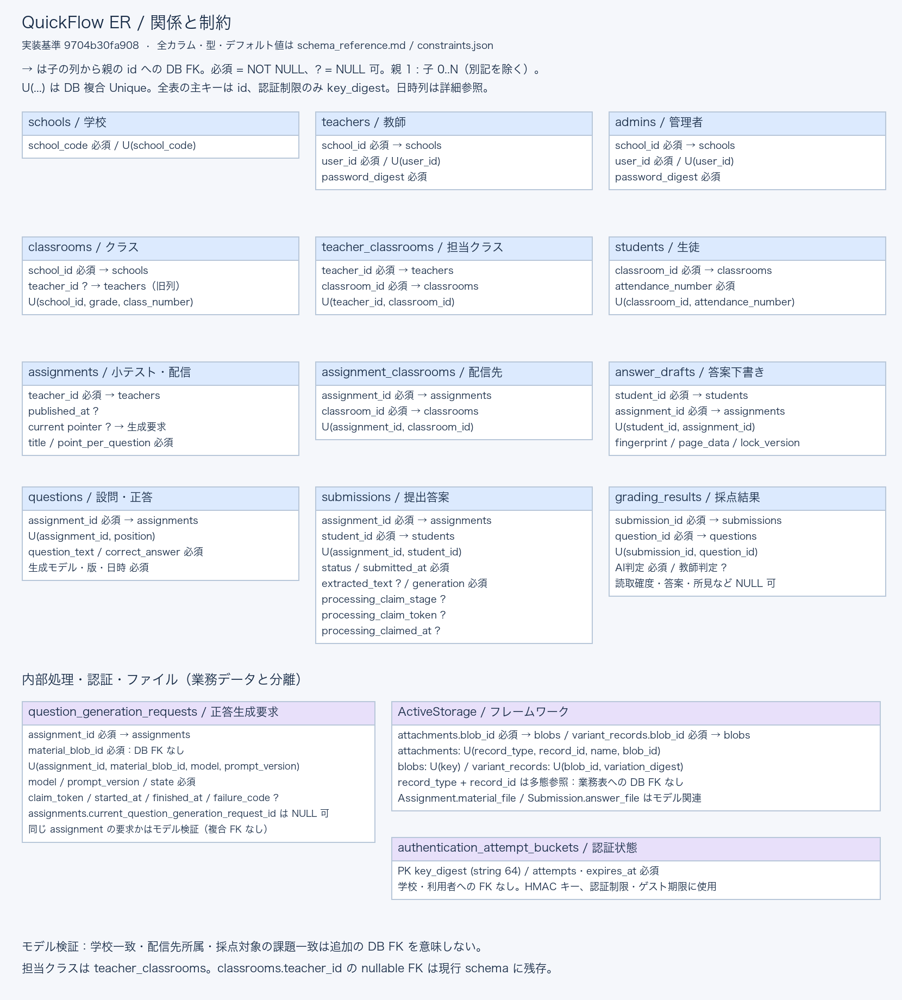
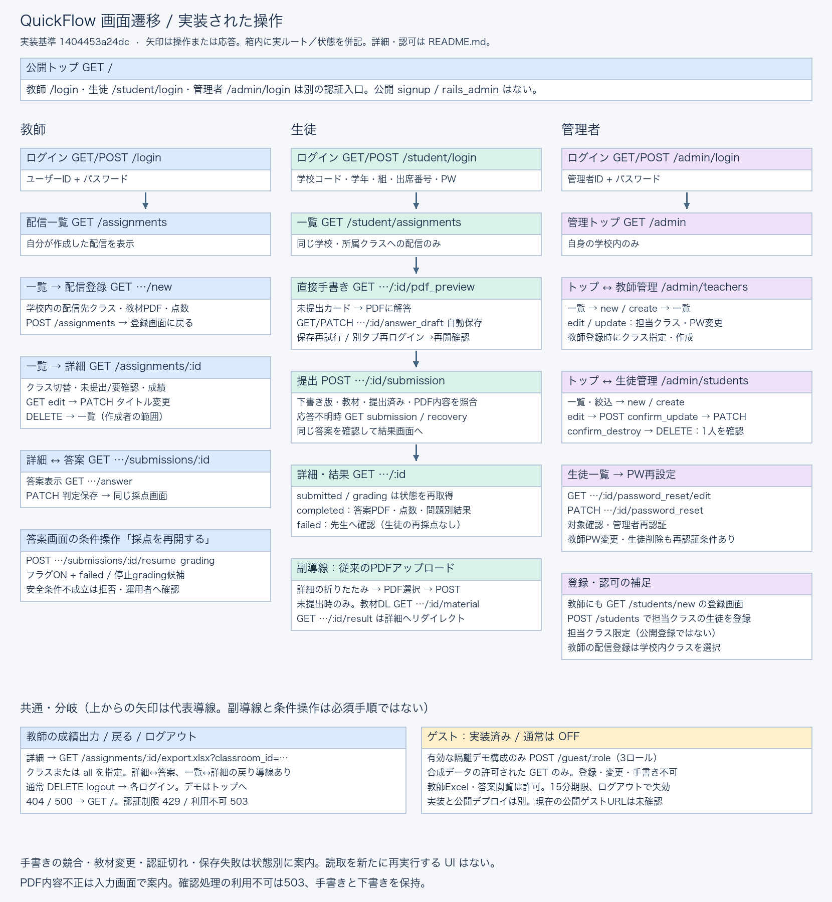

# QuickFlow

## アプリケーション概要

QuickFlowは、中学校数学教師を対象に、授業内で実施する「式の計算」の小テストにおける採点・得点計算・成績処理の業務負担を軽減するとともに、生徒へ採点結果を速やかに返すことで、学習の振り返りを支援する学習支援システムです。

教師は既存のPDF形式の小テストをQuickFlowへ登録し、生徒へ配信します。

生徒はPDFをダウンロードし、端末上で回答したあと、回答済みPDFをQuickFlowへ提出します。

提出された答案はAIが読み取り、各問題を「正解」「不正解」「要確認」の3種類で判定します。

教師は小テスト配信時に「1問あたりの点数」を入力し、AIが正解と判定した問題数に応じて得点を自動計算します。

生徒は採点結果と現在の得点を確認し、AIの判定と自身の解答意図が異なると考えた場合は教師へ申告します。教師は必要に応じて判定を修正し、修正後の得点は自動的に再計算されます。

授業後は、学年・クラス・出席番号・得点を出席番号順に整理し、Excel形式で出力します。

QuickFlowでは、教師が普段使用しているPDF教材をそのまま活用し、採点・得点計算・集計・成績処理をできる限り自動化することで、教師の業務負担を実質的に軽減することを目指します。

## 開発環境

- Ruby 4.0.6
- Ruby on Rails 8.1.4
- PostgreSQL 18.6
- Git
- GitHub

## アプリケーションの実行手順

### 1. リポジトリをクローン

```bash
git clone git@github.com:arduino0420/quickflow.git
```

### 2. アプリケーションのディレクトリへ移動

```bash
cd quickflow
```

### 3. Gemをインストール

```bash
bundle install
```

### 4. データベースを作成

```bash
bin/rails db:create
```

### 5. マイグレーションを実行

```bash
bin/rails db:migrate
```

### 6. Railsサーバーを起動

```bash
bin/rails server
```

ブラウザで以下へアクセスします。

```text
http://localhost:3000
```

## アカウント登録（MVP）

公開サインアップは設けません。学校コードは学校を探す識別子であり、所属を証明する秘密情報ではありません。

教師は、信頼できる運用担当者が本人と学校への所属を確認した後に登録します。
学校・担当クラスは事前に運用担当者が既存モデルで用意します。以下の対話式タスクは、既存の学校に教師だけを追加し、学校やクラスを作成しません。

```bash
bin/rails accounts:create_teacher
```

接続先の環境・DBを確認してから実行してください。パスワードは画面に表示せず端末で入力します。
所属確認の質問への回答だけで本人確認が完了するわけではありません。運用担当者が事前に確認し、確認済みの学校コードを指定してください。
重複ユーザーID・入力エラーの場合は登録しません。ログイン情報は本人へ安全に伝え、ログやリポジトリに残さないでください。

生徒は、ログイン中の教師が `/students/new` の生徒アカウント登録画面から、本人の所属を確認して登録します。
登録できるのは同校の担当クラスだけです。出席番号は1〜40、同じクラス内で重複できません。
登録後も教師のログインを維持し、生徒本人へ学校コード・学年・クラス・出席番号・初期パスワードを安全に伝えます。
生徒本人は `/student/login`、教師は `/login` からログインします。

### 初期管理者の登録

管理者は教師とは別の `Admin` として、既存学校に所属します。信頼できる運用担当者が本人・所属・管理者としての登録権限を事前確認し、対話可能な端末から登録します。
対象環境へのmigration適用と実アカウント作成は別途承認後に行ってください。

```bash
bin/rails accounts:create_admin
```

環境・接続先DBを確認してから、所属確認、既存学校コード、管理者ID、パスワード、確認用パスワードの順に入力します。
パスワード2回は非表示入力です。学校の新規作成、公開サインアップ、seedによる初期パスワード設定は行いません。
存在しない学校コード・重複管理者ID・パスワード不一致・非対話実行は拒否します。
既存の学校コードであれば別学校でも登録可能です。学校コードは所属の証明にならないため、登録先の正当性は運用担当者が確認してください。
管理者IDは管理者全体で一意であり、教師IDとは別に管理します。登録によって教師・生徒のアカウントや権限は付与されません。
パスワードは教師と同じ既存条件（作成時必須、最大72バイト、独自の最低文字数なし）とし、ハッシュだけを保存します。
管理者向けの最低文字数強化は今後の検討事項です。パスワード再設定トークンは実装していません。

### 管理者ログイン・ログアウト

管理者は `/admin/login` から管理者IDとパスワードでログインします。成功時はセッションを再生成し、`admin_id`だけを設定して `/admin/` の管理者トップへ移動します。
教師・生徒のログイン状態は引き継ぎません。失敗時はIDの存在にかかわらず共通エラーを表示し、パスワードを再表示しません。
管理者画面は `Admin::BaseController` で認証を必須化し、セッションのIDから取得した管理者自身の学校だけを参照します。URLやフォームの学校IDは採用しません。
ヘッダーのログアウトボタンはCSRF保護付きの `DELETE /admin/logout` を送信し、セッションを破棄します。管理者画面・ログイン画面はキャッシュを禁止します。
管理者セッションだけでは教師・生徒画面へアクセスできません。教師・生徒としてログインし直した場合も、管理者セッションは破棄されます。
教師一覧は `/admin/teachers`、新規登録は `/admin/teachers/new` です。学校コード（読み取り専用）、教師ID、パスワード・確認、担当クラスの順に表示します。所属学校はログイン中の管理者から決定し、学校コードの送信値は採用せず、学校ID・クラスIDの直接指定は拒否します。

担当クラスは1〜3年・1〜10組から複数選択でき、0件も許可します。選択済みの既存クラスを再利用し、未登録の選択クラスだけを作成します。教師・クラス・担当関係は一つのトランザクションで保存し、学校単位のロックと既存の一意制約で重複を防ぎます。保存競合時は全体を取り消し、再入力を案内します。既存教師の担当関係や生徒・答案・採点結果は変更しません。

教師一覧の「編集」から `/admin/teachers/:id/edit` を開き、担当クラスとパスワードを変更できます。学校コード・教師IDは変更できず、教師IDはモデルの通常更新でも変更を拒否します（直接SQLや検証省略の保存は対象外）。新しいパスワードが空欄の場合は現在のパスワードを維持し、入力した場合は確認欄との一致を必須とします。

担当解除は対象教師の中間レコードだけを削除します。クラス・生徒・小テスト・答案・PDF・採点結果や、他教師の担当関係と小テストの所有権は変更しません。既存担当に表示範囲外（1〜3年・1〜10組以外）または他校のクラスがある場合は、黙って解除せず更新を拒否します。

更新は学校・教師のロック内で一括保存します。署名付きの編集確認情報を教師の最新状態・担当関係と照合し、古い画面・改ざん・別の管理者や教師に対する確認情報を拒否します。競合時は編集画面を開き直してください。失敗時はパスワードを再入力してください。この競合制御は管理者の登録・編集処理が共通のロック規約を使う前提であり、直接SQLなどによる並行変更まで全面的に防ぐものではありません。

**パスワード再設定後も、既存の教師ログイン済みセッションは継続します。** 現在はセッションの `teacher_id` から教師を取得しており、パスワード変更による既存セッションの失効は実装していません。旧パスワードでの新規ログインは拒否します。全セッション失効の仕組みは別途検討事項です。

教師削除は実装していません。今後追加する管理者Controllerも共通の認証を継承し、対象データを管理者の学校で絞り込む必要があります。

### 旧担当情報のコピー（関連切替前の移行用）

`teacher_classrooms:backfill` は、既存の `Classroom.teacher_id` を中間テーブルへコピーする書き込み用タスクです。
学校一致・参照先を旧担当と既存中間レコードの両方で監査し、不整合があればコピーしません。
既存の中間レコードは削除・更新せず、不足する組だけを追加します。
コピー後は教師ID・クラスIDの組を照合し、エラーや不一致では今回の追加をすべてロールバックします。
出力は `legacy_pairs`（旧担当数）、`inserted_pairs`（追加数）、`already_present_pairs`（コピー済み数）、`total_pairs`（中間テーブル総数）のみです。

専用テストDBでの実行例（データを書き込みます）:

```bash
RAILS_ENV=test DATABASE_URL=postgresql:///quickflow_test bin/rails teacher_classrooms:backfill
```

開発・本番環境での実行には別途承認が必要です。接続先・バックアップを確認し、担当変更やクラス作成を止めた移行時間帯に実行します。
処理中は学校・教師・クラス・中間テーブルの書き込みをロックします。既存の書き込みと競合した場合は待たずに中止します。
担当取得・生徒登録の認可は `teacher_classrooms` を使用します。旧カラムは移行用にのみ残しています。
このコピー処理は新しい関連を利用するサーバーの初回起動前に完了させてください。関連切替後・担当解除機能の利用開始後には実行しないでください。
再実行すると、意図的に解除した旧担当関係を復活させるおそれがあります。

### 開発DBの関連切替手順（別途承認後に実施）

以下は手順書であり、開発DBへの適用は別途承認が必要です。切替中はRailsサーバー、Jobワーカー、console、定期実行や運用スクリプトを止め、書き込みを停止してください。
先に既存DBのバックアップを `pg_dump -Fc` で取得し、保護された場所へ保存します。バックアップが読めること、必要な場合に復元できることを確認します。
添付PDFのストレージも別途保全します。DBバックアップにPDF本体は含まれません。

1. 接続先が `quickflow_development` であることと、未適用migrationの一覧を確認する。
2. 中間テーブル追加だけを適用する（未適用の場合）。
   `RAILS_ENV=development DATABASE_URL=postgresql:///quickflow_development bin/rails db:migrate:up VERSION=20261015040000`
3. 同じ接続指定で `bin/rails teacher_classrooms:backfill` を実行し、成功の件数を保存する。不整合や競合があれば中止してサーバーを起動しない。
4. 書き込み停止を維持したまま、以下の読み取り専用SQLで旧担当の欠落と中間レコードの学校不一致・参照不整合がともに0件であることを確認する。
5. `RAILS_ENV=development DATABASE_URL=postgresql:///quickflow_development bin/rails db:migrate:up VERSION=20261015050000` を実行し、旧カラムをNULL許可にする。
6. migration適用状況と既存クラス・生徒・配信・答案・採点結果の件数、代表データの関連が変わらないことを確認する。
7. 新コードでRailsサーバー・ワーカーを起動し直し、担当クラス表示・生徒登録・配信・既存答案表示を確認して利用を再開する。実AI呼び出しを伴う確認は別途承認する。

照合用SQL（対象DBのpsqlから実行）:

```sql
BEGIN READ ONLY;
SELECT COUNT(*) AS missing_legacy_pairs FROM (
  SELECT teacher_id, id AS classroom_id FROM classrooms
  EXCEPT SELECT teacher_id, classroom_id FROM teacher_classrooms
) missing;
SELECT COUNT(*) AS invalid_pairs FROM teacher_classrooms tc
LEFT JOIN teachers t ON t.id = tc.teacher_id
LEFT JOIN classrooms c ON c.id = tc.classroom_id
LEFT JOIN schools s ON s.id = c.school_id
WHERE t.id IS NULL OR c.id IS NULL OR s.id IS NULL
   OR t.school_id IS DISTINCT FROM c.school_id;
COMMIT;
```

担当解除は中間レコードのみを削除し、クラス・生徒・答案・配信・採点結果を削除しません。
同じクラスの担当になっても、他教師が作成した小テストの閲覧・採点権限は付与されません。
複数担当・未担当クラスを利用した後は旧カラムで関係を表現できません。NULL許可migrationの自動rollbackは不可とし、復旧は多対多対応版での修正を基本とします。

## 小テストの削除

作成者の教師だけが詳細画面の「この小テストを削除する」から削除できます。同校の別教師にも削除権限はありません。
確認ダイアログには小テスト名と、提出答案・採点結果・成績も削除され元に戻せないことを表示します。
未配信の小テストは、作成者が `/assignments/:id` を開いて削除できます。

対象の問題・提出・読み取り結果・AI判定・教師判定・配信情報を1トランザクションで削除します。
アカウント・学校・クラス・他の小テストは保持します。他の小テストをまたぐ不整合データは巻き込まず削除を中断します。
提出の保存〜PDFアップロード完了と削除は小テスト単位のアドバイザリロックで調停します。
教材の初回配信も、レコード作成後からコミット後の教材アップロード完了まで同じロックで保護します。
削除は小テスト（FOR NO KEY UPDATE）→提出（ID順）→問題（ID順）の順で行ロックを取得し、実行中のAI処理が終わるまで待ちます。
待機中はJobの外部キー確認（KEY SHARE）を妨げず、関連データを削除した後の本体DELETEでロックを強めます。
既に送信済みの外部AI要求を中断する仕組みではありません。削除済み対象の待機Jobは安全に終了します。

### PDF削除と障害時の確認

教材PDF・答案PDFの添付情報はDB処理で削除します。実ファイルはDBコミット後、Rails標準の
`ActiveStorage::PurgeJob` で非同期削除します。DB削除完了は物理ファイル削除完了を意味しません。
共有Blobは他の添付先が残っている間は削除しません。ストレージ全体や他の小テストのファイルを削除しないでください。
本番ではSolid Queueワーカーの起動・監視が必要です。

キュー登録に失敗した場合も、DB削除がコミット済みなら削除済みであることとPDF後処理が未完了であることを画面で案内します。
`Assignment PDF cleanup` ログには再処理用のBlob ID・ストレージ識別子・オブジェクトキーを記録します。
生徒名・小テスト名・答案内容・APIキーは記録しません。この運用ログの閲覧権限は制限してください。
削除Jobの実行失敗はActive Job / Solid Queueのエラーログ・失敗Jobを確認してください。

運用担当者がストレージ・キュー障害を解消した後、削除対象のログと環境・DBを確認して再処理します。
Blobが残っている場合、対象IDだけを再取得し、`attachments.exists?` がfalseであることを確認して `purge_later` を再登録します。
共有Blobは再処理対象にしません。Rails標準のpurgeはBlobレコードを先に削除するため、物理ファイル削除だけ失敗するとBlobが存在しない場合があります。
その場合、失敗Jobを無条件に再実行しても復旧できません。削除ログのストレージ・キーに対応する対象オブジェクトだけを、ストレージ管理機能で確認・削除してください。
既存Blobが同じキーを参照していないことも確認し、ファイル名やディレクトリ全体を指定した一括削除は行わないでください。

**外部OpenAI側に既にアップロードされたファイルは今回の削除対象外です。**
現行実装は外部ファイルIDを永続保存していないため、外部側のファイルを正確に追跡して削除することはできません。
小テスト削除処理から外部OpenAI APIへの削除要求は行いません。

## 設計資料

### チェックシート

[チェックシート](https://docs.google.com/spreadsheets/d/1G-4Q3SS79nOKc3IJGaaYNftkwM0XktCnIgPAiMZ-1ug/edit#gid=1475280975)

### カタログ設計

[カタログ設計](https://docs.google.com/spreadsheets/d/1G-4Q3SS79nOKc3IJGaaYNftkwM0XktCnIgPAiMZ-1ug/edit#gid=0)

### テーブル定義書

[テーブル定義書](https://docs.google.com/spreadsheets/d/1G-4Q3SS79nOKc3IJGaaYNftkwM0XktCnIgPAiMZ-1ug/edit#gid=524149616)

### ワイヤーフレーム

[QuickFlow ワイヤーフレーム](https://whimsical.com/Lj1FAP2VsasTMNMjFAfDb4)

## ER図



## 画面遷移図



## AI読み取り・採点（Phase 8・9）

教師の初回配信保存後、`QuestionGenerationJob` を登録します。配信操作はAIの応答を待たずに完了し、
バックグラウンドで教材PDFから正答・採点条件を生成して `Question` に保存します。
答案提出後、`AnswerReadingJob` が答案を読み取り、`Submission.extracted_text` にJSONを保存します。
その後 `AnswerGradingJob` が保存済みの正答だけを使って採点結果を保存します。生徒側から正答生成は行いません。
教材の正答は `QuestionGenerator`、採点は `AnswerGrader` が担当します。
正答の準備前に読み取りが完了した場合は、答案と読み取り結果を残して `grading` のまま待機します。
生成Jobの完了時に、読み取り済み・未完了の答案の採点Jobを登録します。待機中の定期再試行はありません。
生成やJob登録が失敗した場合はエラーと失敗キャッシュを記録し、読み取り済み答案を `failed` にします。
失敗後に提出・読み取りされた答案も、採点Jobが失敗記録を確認して停止します。答案読み取りの流れは維持します。

### API料金を抑える仕組み

- 教材の正答は教師の初回配信後に生成し、保存済みの `Question` を全生徒で再利用します。
- 正答生成中は小テストの `FOR NO KEY UPDATE` ロックを保持し、重複生成を防ぎながら別の生徒の提出時の外部キー確認を妨げないようにします。
- 保存済み正答は必須項目、問題番号の重複、1から連続する順番、採点条件JSONを検証します。不正な保存データは停止し、自動再生成しません。
- 読み取り済みの `extracted_text` は再利用します。読み取り・採点中も提出のDBロックを保持します。
- 採点が必要な問題だけを、生徒1人につき1回のテキストリクエストで送ります。採点時にPDFは送りません。
- 未記入は不正解、判読困難・複数解釈・対応付け不能・指定解法確認不能は要確認とし、これらはAPIを使わず処理します。
- 全問が上記に該当する場合、採点APIの呼び出しは0回です。
- SDKの自動再試行は無効です。完了・失敗した提出のJobも、自動的に処理し直しません。
- 正答生成の失敗も既存のキャッシュに記録し、同じ教材・モデル・プロンプト版での再呼び出しを抑えます。

新規答案がN人分あり、全員にAI採点が必要な場合、AI応答生成は最大 `2N + 1` 回です。
内訳は教材の正答生成1回、答案読み取りN回、まとめ採点N回です。
これとは別に、教材1回・答案N回のファイルアップロードがあります。
読み取り済み答案のPhase 9だけなら、正答生成1回と採点最大N回です。
保存済みの正答があれば、その正答生成も不要です。

失敗キャッシュは教材ファイル・モデル・プロンプト版ごとに分けています。
キャッシュが消去・退避された場合や、開発環境のメモリキャッシュが再起動で失われた場合は再生成されることがあります。
モデルを明示的に変更した場合も、新しい設定で生成を試みます。
API応答後、DB保存前にプロセスが停止した場合は、次の実行で呼び出しが重複する可能性があります。
ロック中はDB接続を保持するため、大量同時提出時の待ち時間は今後の確認事項です。
保存済み正答の検証だけでは、末尾の問題の欠落は検出できません。
既存画面は初回配信だけで、同じAssignmentの再配信・教材差し替えはありません。
もう一度フォームから配信すると新しいAssignmentになり、別の小テストとして正答を1回生成します。
生成Jobは配信時の教材ファイルIDを受け取り、変更されていれば生成せず停止します。
新しく生成する採点条件JSONには `material_blob_id` を保存し、保存後の教材変更も検出して停止します。
この項目がない従来の正常な正答は再利用しますが、教材変更を検出できません。
変更前に配信済みの小テストに生成Jobを自動追加する処理はありません。正答がなければ採点は待機します。
採点Jobの登録失敗は正答・読み取り結果を残して失敗扱いにします。
失敗キャッシュ消失やJobの異常停止で待機が残る場合も、自動生成・定期再試行はしません。

### モデル設定

環境変数で設定できます。用途別の設定が共通設定より優先されます。

| 環境変数 | 用途 |
|---|---|
| `OPENAI_MODEL` | 共通のモデル |
| `OPENAI_ANSWER_READING_MODEL` | 答案PDFの読み取り |
| `OPENAI_QUESTION_GENERATION_MODEL` | 教材PDFからの正答生成 |
| `OPENAI_ANSWER_GRADING_MODEL` | テキストでのまとめ採点 |

未設定時は既存の `gpt-6-astra` を維持します。これを低価格モデルとして推奨するものではありません。
設定するモデルの利用可否・料金は実API検証前に確認してください。
PDF処理用モデルにはPDF入力への対応も必要です。APIキーは従来どおりRails credentialsの `openai.api_key` を使います。

APIの待ち時間は1リクエストにつき既定120秒です。環境変数 `OPENAI_TIMEOUT_SECONDS` で正の秒数を設定できます。
アップロードと応答生成にはそれぞれ適用され、処理全体の上限ではありません。
タイムアウトはJobがエラーを記録して失敗扱いにし、自動再試行しません。正答生成の失敗はキャッシュにも記録します。

### 保存データと安全な判定

`Question.grading_rule` は既存のtextカラムに、`criteria`（採点条件）と
`requires_work`（途中式・指定解法の確認が必要か）、`material_blob_id`（生成元教材のID）のJSONを保存します。
Phase 8は途中式を保存しないため、確認が必要な問題は要確認になります。
問題番号が一意に一致する答案を、保存済みの正答・採点条件に基づいて採点します。問題文の一致確認は行いません。
番号が不明・重複・欠落する場合は、順番から推測せず要確認にします。
保存済み採点条件のJSONが不正な場合は、採点開始前に停止します。

生徒の最終解答は読み取り値のまま保存し、教師判定は変更しません。
AIを使わない判定では、`ai_model_name` に `local-rules` を保存します。
AIを使った判定と正答生成では、応答のモデル名（取得できなければ設定モデル名）・プロンプト版・日時を保存します。
読み取り確信度はPhase 8で取得していないため `NULL` とします。
全問題の結果保存を完了すれば、要確認を含んでも `Submission.status` は `completed` です。
技術的な失敗は `failed` とし、保存済みの読み取り結果は残します。
正答生成に失敗した場合は仮の正答を保存せず、採点を中止します。

### テスト

RSpecでは実OpenAIクライアントの生成を禁止し、明示的なスタブだけを使用します。
関連テストは以下で実行できます。

```bash
bundle exec rspec spec/services spec/jobs spec/requests/assignments_spec.rb spec/requests/student_submissions_spec.rb
```

実API・実際の数学答案を使う確認は、別途許可を得てから実施します。
教師の判定修正・得点計算・結果画面・成績出力はPhase 9には含めません。

### 関連データの整合性（Issue #43）

モデルの通常保存（新規作成・更新）では、次の不整合を拒否します。

- TeacherClassroomの教師とクラスの学校が異なる（多対多への切替に伴い、旧Classroomの検証から移行）。
- AssignmentClassroomの配信先クラスと小テスト作成教師の学校が異なる。
- Submissionの生徒所属クラスへ小テストが配信されていない、または生徒と作成教師の学校が異なる。
- GradingResultの問題と提出が別の小テストに属している。

同じ学校の別教師が担当するクラスへの配信は許可します。
既存の表示側の認可・絞り込み、得点計算・削除時の防御は維持します。
DB構造や採点基準は変更せず、既存データの自動修復・削除も行いません。
直接SQL、`update_columns`、検証を省略した保存などはこの検証を迂回できます。
教師の所属学校や生徒の所属クラスなど、関連先を後から変更した際に、
既存の全関連レコードを自動再検証する仕組みではありません。

### 採点失敗・長時間未更新の答案を調査する（読み取り専用）

運用担当者は、指定した答案の保存状態を次のコマンドで確認できます。
`123` は実在するSubmissionのIDに置き換えてください。

```bash
bin/rails 'recovery:inspect[123]'
bin/rails 'recovery:candidates'
bin/rails 'recovery:candidates[30,100]'
```

`candidates` は、全ての `failed` と、指定分数より前から更新されていない
`submitted`・`grading` を、更新日時・IDの古い順に表示します。
引数は「経過分数、表示上限」で、省略時は30分・100件、表示上限は最大1000件です。
経過分数は1〜525600分（365日）、表示上限は1〜1000件の整数で指定してください。
経過分数の上限は調査用引数の制限であり、採点のタイムアウト条件ではありません。
範囲外の入力は日時計算・検索前に日本語の入力エラーとして拒否します。
表示上限を超える対象は表示しません。
長時間未更新でも、キュー待ちや実行中の可能性があり、処理停止とは断定しません。

本番環境を調べる場合は、接続先を確認したうえで `RAILS_ENV=production` を付けます。
結果は標準出力へJSONで表示し、ID・状態・日時・件数・確認理由を出力します。
生徒名、答案・正答本文、ファイル名、ストレージキーは出力しません。
`reading`・`questions` は `missing`（なし）、`valid`（既存の形式検証に適合）、
`invalid`（形式不正・不整合）を表します。数学的な正しさを保証するものではありません。

この機能はDBを更新せず、Jobの登録・実行、実OpenAI API呼び出し、キャッシュ操作、
PDF実体の取得・解析を行いません。添付レコードとBlobレコードがあっても、
PDF実体の存在・破損は未確認です。失敗キャッシュ、待機中・実行中Job、失敗原因、
採点時点の教材との一致も未確認として表示します。
調査中に通常の採点処理が進む可能性があるため、結果はその時点の観測情報です。

全問分の採点結果がある `failed` も「既存結果の確認が必要」と表示します。
自動で `completed` へ変更せず、既存結果・教師判定を保持します。
表示される再開位置は検討対象であり、復旧の安全性を保証しません。
復旧、再提出、再採点、世代番号追加、キャッシュ解除は実装していません。

専用テストDBでの関連RSpec:

```bash
RAILS_ENV=test DATABASE_URL=postgresql:///quickflow_test bundle exec rspec spec/services/recovery spec/tasks/recovery_spec.rb
```
