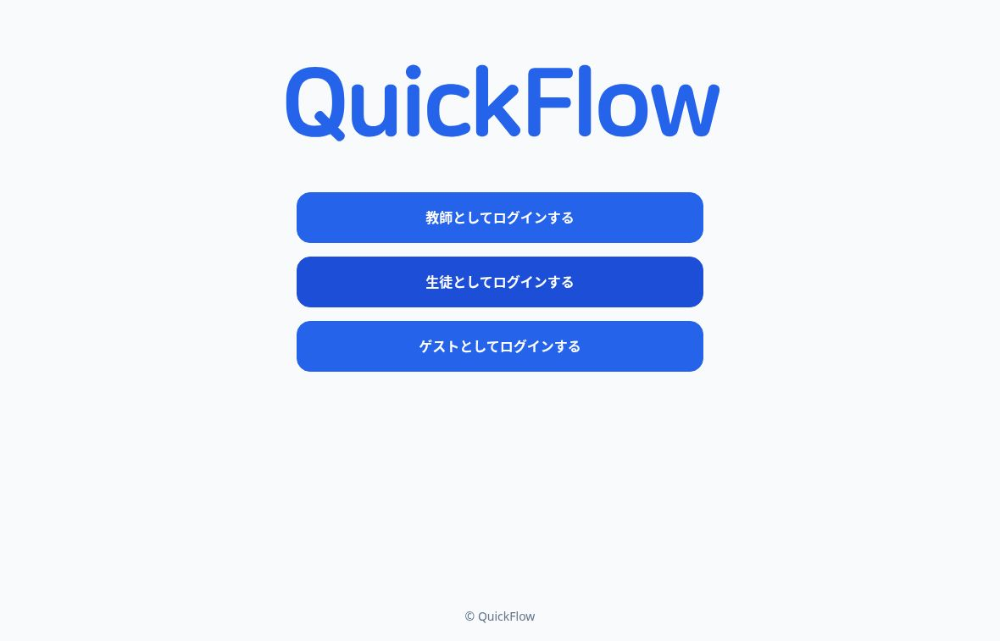
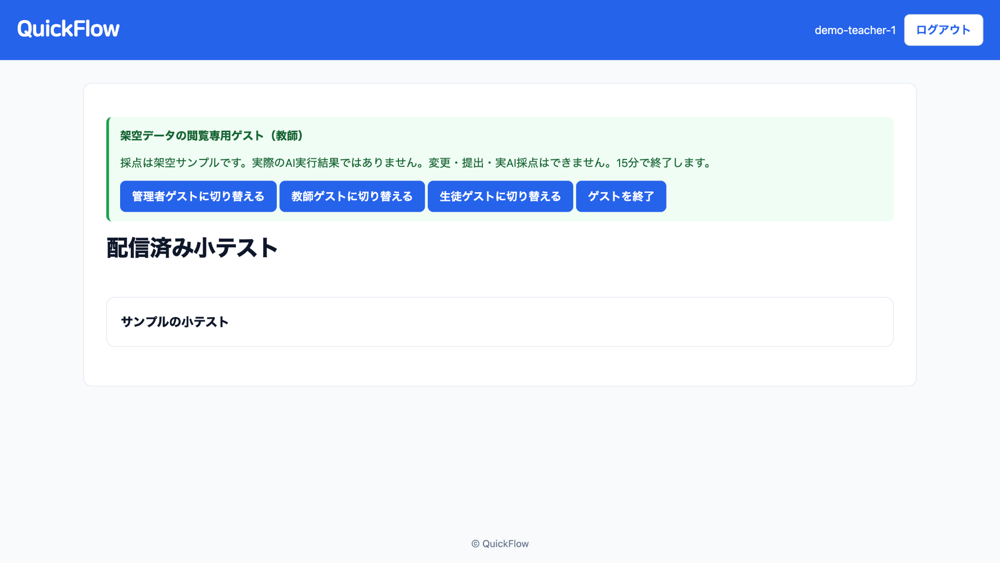
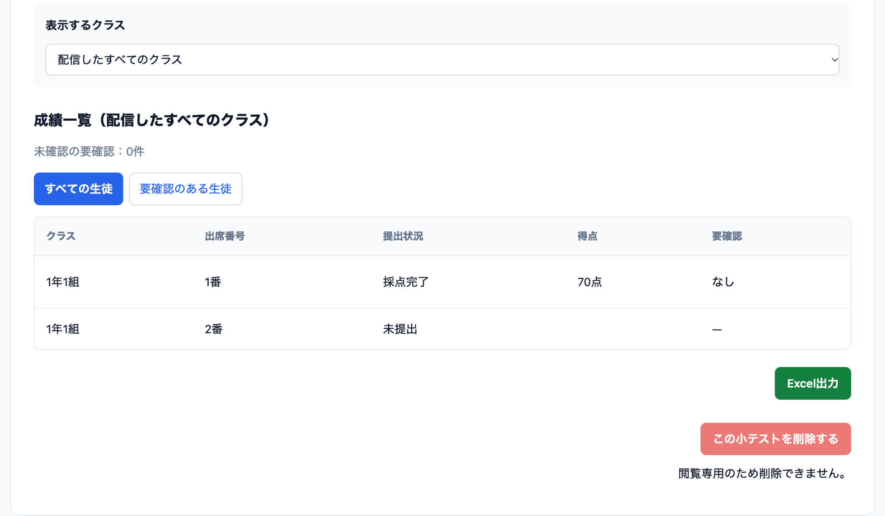
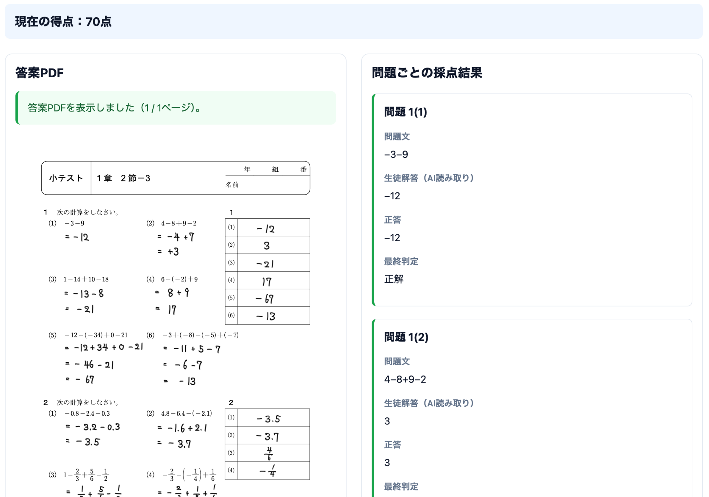
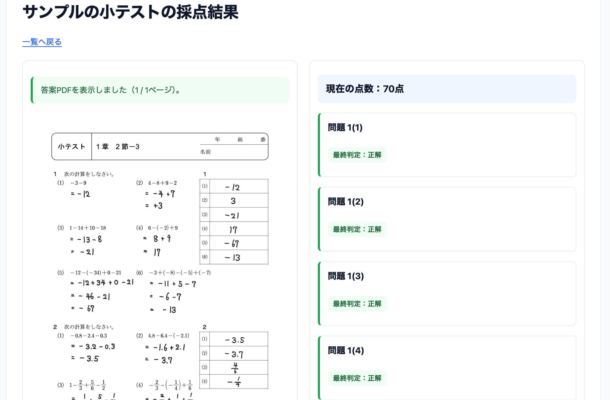
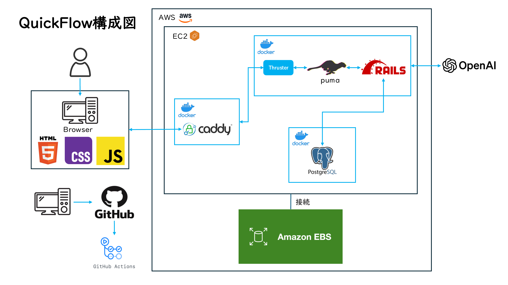

# QuickFlow 詳細資料

[簡潔なREADMEに戻る](../../README.md)

READMEの整理に伴い、既存の画面説明・構成図・起動／テスト手順・検証記録をここへ移しました。撮影日や検証時点、未確認事項は当時の記録として保持しています。過去のCI成功や画像を、現在の公開環境の動作保証とみなさないでください。技術バージョンはリポジトリの設定・lockファイルを正とします。

中学校数学の小テストを、PDF教材の配信から手書き解答・採点・成績出力まで支援するRailsアプリです。教師の採点や転記の負担を減らし、生徒へ結果を返すまでの時間を短くすることを目指しています。

教師判定がない問題にはAI判定を使い、教師が判定を保存した問題には教師判定を優先します。読みにくい答案は「要確認」として残し、教師が答案と判定を確認・修正できます。要確認の問題は得点に加算しません。

**[公開アプリ](https://13-231-93-159.sslip.io/) · [閲覧専用ゲスト](https://qfd-4c18332acca47671.13-231-93-159.sslip.io/) · [必須39項目の対応表](../implementation/issue103_submission_evidence.md)**



## 主な機能

| 利用者 | できること |
| --- | --- |
| 教師 | 担当クラスの生徒登録、PDF教材の配信、答案とAI判定の確認、最終判定の修正、得点集計、クラス別のExcel出力 |
| 生徒 | 配信されたPDFへの手書き、下書きの自動保存・復元、正式提出、答案と採点結果の確認 |
| 管理者 | 自校の教師・生徒の登録や所属管理、パスワード再設定、条件を満たす生徒の削除 |

学校・担当クラス・配信先・作成者に応じてアクセスを制限します。公開サインアップはありません。管理者の初期登録は運用担当者が行い、教師は運用担当者または自校の管理者が登録します。生徒は自校の管理者または担当クラスの教師が登録します。通常の入口は教師 `/login`、生徒 `/student/login`、管理者 `/admin/login` です。[登録・認証・管理操作の詳細](../implementation/operations_details.md)を参照してください。

## ゲストで画面を見る

公開トップの「ゲストとしてログインする」から、管理者・教師・生徒の役割を選べます。パスワードの入力は不要です。

- 学校本番とは別のDB・保存領域を使う、架空データ専用の閲覧環境です。
- 成績一覧、答案PDF、採点結果、管理画面を確認できます。
- 登録・編集・削除・手書き・提出・実AI採点はできません。画面の判定と得点は用意したサンプルです。
- セッションは15分で終了します。役割の切替やログアウトで以前のセッションは失効します。

ゲストは通常アカウントの代わりではありません。実生徒のデータや学校用の認証情報を入力しないでください。[分離構成と運用条件](../implementation/issue51_predeployment_runbook.md#公開guest評価導線同一server架空データ専用)を公開記録にまとめています。

## 使い方と画面

トップ画像は、2026-11-04 UTCに冒頭の公開アプリへアクセスして撮影した実画面です。ロゴとログインボタンの現在の表示を確認しました。稼働commitは今回照合していません。

教師の小テスト一覧・成績一覧・答案詳細・生徒結果の4枚は、2026-11-04に利用者から提供された閲覧専用guestの実画面です。PNG原本をそのまま掲載し、画面の文言や値を画像編集で差し替えていません。撮影環境と稼働commitは独立に照合していません。学校・アカウント・得点は公開guest用のサンプルで、教材・答案PDFは利用者が公開を承認したものです。判定と70点は用意した表示例で、実AIの実行結果ではありません。

2026-10-24の旧画像撮影当時、旧版の内蔵PDFビューアでは空白を観測しました。`0812708` は答案閲覧を既存PDF.jsへ変更した版で、当時の本番guestで描画完了9回・実画像4場面を確認しました。その撮影時には通常の認証付き本番描画を試験しておらず、ローカルの架空通常アカウント試験とCIが根拠です。原本タブではChrome内蔵PDF表示の黒画面も観測し、内部原因や全環境での安定性は確定していません。これらは今回提供された画像とは別時点の検証記録です。

### 1. 教師がPDF教材を配信し、成績を確認する

通常利用では、PDF教材・1問の点数・配信先クラスを確認して小テストを配信します。正答生成は非同期で進むため、状態を確認しながら待ちます。成績一覧では、採点済みの得点と未提出を区別できます。





これらの画像は閲覧専用guestです。小テスト一覧からサンプルを開き、成績を確認できます。成績の閲覧とExcel出力を利用できますが、通常教師の配信・編集操作はできません。

### 2. 教師が答案と判定を見比べる

答案PDFと問題ごとの結果を並べて確認できます。通常利用では、教師が最終判定を修正すると得点が再計算され、配信クラスを選んでExcelを出力できます。



この教師答案画像では、氏名欄が空の答案PDFと、問題文・生徒解答の読み取り例・正答・最終判定を確認できます。上部のguest注意表示は画像外です。表示内容は公開guestのサンプルで、実AIの実行や通常教師の判定変更を検証する画像ではありません。

### 3. 生徒が答案と結果を確認する

通常利用の流れは「PDFに手書き → 保存状態を確認 →『提出する』で正式提出 → 採点結果を確認」です。自動保存だけでは提出されません。正式提出は生徒1人につき小テストごとに1件で、提出後は下書きの編集や答案の差し替えはできません。提出時に通信が途切れた場合は、画面の提出状態を確認してください。答案PDFの保存後に採点処理の開始に失敗した場合も、再提出せず教師に連絡します。採点では「正解・不正解・要確認」を区別し、要確認は得点に加算しません。



手書きの編集画面は閲覧専用guestでは操作できません。[過去の合成入力試験画像（黒い線）](../implementation/issue99-evidence/02-student-saved-handwriting.png)と[保存・再読込の検証記録](../implementation/issue103_submission_evidence.md)を別に残しています。この旧画像は試験用タイトルと黒い線を示すもので、保存状態の表示は撮影範囲外です。保存・復元の成立は検証記録を参照し、現在の編集画面を撮り直した画像とは区別してください。

### 利用時の注意

- 黒ペン・消しゴムと複数ページに対応します。ペン・消しゴムが未選択のときは筆記せず、従来のスクロール操作になります。選択中は1接点で描画・消去し、2接点で移動・拡縮します。同じ道具をもう一度選ぶと選択を解除できます。
- 通信断で未保存のまま画面を閉じると、筆跡が失われる場合があります。画面を閉じず、復旧後の保存状態を確認してください。
- 従来のPDFアップロードも利用できます。答案PDFは25MiB、提出HTTP本文は32MiBまでです。暗号化PDFの手書きexportには対応していません。
- AIは教師の判断を補助します。誤判定や読み取りの不確かさを前提に、答案と結果を確認してください。技術的な失敗は採点完了と区別します。
- 採点失敗や停止の疑いがある場合は、教師から運用担当者へ連絡します。経過時間だけで再実行したり、queueやPDFを削除したりしないでください。

[採点の復旧・外部AIへの送信と保持・管理操作の注意](../implementation/operations_details.md)を参照してください。パスワードの条件、登録方法、再認証・削除の手順も同文書にまとめています。

## 技術構成

| 領域 | 使用技術 |
| --- | --- |
| アプリケーション | Ruby 4.0.6 / Rails 8.1.4.1 / Puma / Hotwire・Importmap |
| データ・非同期処理 | PostgreSQL（開発基準18.6）、Active Record・Active Storage、Solid Queue・Cache・Cable |
| PDF・成績 | PDF.js / pdf-lib / qpdf 12.4.2 / caxlsx |
| AI連携 | OpenAI SDK（読取・正答生成・判定支援） |
| 配備・品質確認 | Docker / AWS EC2・Caddy / GitHub Actions・RSpec |

AI処理には永続要求台帳とclaimによる重複・競合対策を用い、教師の最終判定を保持します。構成と根拠は[設計資料](../design/README.md)と[実装・試験の対応表](../implementation/issue103_submission_evidence.md)を参照してください。リポジトリのKamal設定を、そのまま実稼働設定とみなさないでください。

PDFの事前確認にはqpdf 12.4.2を使います。ローカル起動・テスト前に `bin/install-qpdf` を実行してください（curl/unzipが必要）。公式配布物のSHA-256を検証し、`vendor/qpdf` 内だけに配置します。[PDFの受入条件・実行上限](../implementation/operations_details.md#pdf読み取り事前確認issue-48)を確認してください。

### ネットワーク構成（通常版）

通常版の主要な通信経路とコンテナ構成を示します。CaddyがHTTPS通信を受け、アプリコンテナ内のThrusterを通して、Puma上で動くRailsへ渡します。PostgreSQLは別コンテナで動作し、RailsからOpenAI APIを利用します。



[構成図をPDFで開く](../design/network_architecture.pdf)

図は通常版の概略です。ゲスト版の隔離構成と、アプリコンテナ内で動くSolid Queueの処理プロセスは省略しています。GitHub ActionsはCIを示し、本番への自動デプロイを意味しません。

## 検証状況

- リポジトリの比較基準は [dabaf56（PR #189統合後）](https://github.com/arduino0420/quickflow/commit/dabaf56c613aed934cd4f8b2ece09c8e536a4346)です。同revisionの[CI40994476917](https://github.com/arduino0420/quickflow/actions/runs/40994476917)は2026-10-30に全4ジョブ成功。統合前headの全RSpec 2,246件・失敗0件は[PR #189の既存検証記録](https://github.com/arduino0420/quickflow/pull/189)にあります。いずれも今回のREADME見直しで再実行した結果ではありません。
- 2026-10-30の読み取り専用確認時、通常の稼働revisionは [c2e1d52（PR #188）](https://github.com/arduino0420/quickflow/commit/c2e1d529b976d0d2984ce6830eed4517d3e1f567)。手書き処理4ファイルのSHA-256も同revisionのソースと一致しました。guestは意図的に閲覧専用の旧ベース（container `quickflow-issue186-guest-57012aa`）を維持しています。通常・guestの版が異なることは不具合ではありません。リポジトリのheadと稼働版は区別します。
- 過去の配備基準 [0812708](https://github.com/arduino0420/quickflow/commit/0812708fcc4d82dca02eb7d9e9c4594716d64e0b)と[CI40079428699](https://github.com/arduino0420/quickflow/actions/runs/40079428699)（全4成功・RSpec 2,062件）は履歴です。その際の通常停止85.8秒・guest停止16.3秒、データ・認証情報・network/TLS維持の記録を、現在の稼働版の検証と混同しません。
- TLS・Secure cookie、DB/PDF保全と隔離復元、worker・queue、限定した公開/guestフローを確認し、[運用監査 #51](https://github.com/arduino0420/quickflow/issues/51)と[限定フロー検証 #99](https://github.com/arduino0420/quickflow/issues/99)に完了根拠を記録しました。`/up` は起動確認であり、AI・DB・queue全体の健全性を保証しません。
- 通常の実AI配信・提出・採点、および新版の手書き・保存の成功は所有者からの報告です。現場のChromebookで筆記できたとの報告もありますが、担当者はその動画や実機を独立検証しておらず、その報告だけで保存・正式提出の成立を確認したとは扱いません。担当者によるLenovo実機の独立検証、すべての端末・PDF・実通信障害、AIの数学的正確性を保証するものではありません。
- 2026-11-04に担当者が行った撮影は公開トップの閲覧のみです。通常アカウントでの認証、実生徒データの変更、答案提出、AI実行はしていません。同日に利用者から提供された4枚は架空データのguest画面で、通常アカウントや実AI動作の検証ではありません。
- 2026-10-24の撮影では閲覧だけを行い、実生徒データの変更、答案提出、AI実行はしていません。旧表示試験用の長文画像や失敗履歴は、[検証資料](../implementation/issue103_submission_evidence.md)に残しています。

提出準備は[39項目の対応表](../implementation/issue103_submission_evidence.md)に集約しています。技術的な確認と、本人によるDPro再投稿・メンター通知・最終提出、学校側の受入判定は分けています。

## MacのVS Codeから開発・検証する

編集の出発点はMacのローカルcheckoutです。VS Codeで編集し、同じフォルダの`Dockerfile`と`compose.yaml`で通常版を再ビルドします。Caddy → Thrust → Puma/Rails production＋Solid Queue → PostgreSQLの3役構成を使い、RSpecはMacの別テストDB・保存先で実行します。

[初回準備](../implementation/local_docker_workflow.md)が終わった後の日常操作:

```sh
code .
# VS Codeで編集・保存した後
docker --context desktop-linux compose build web
docker --context desktop-linux compose up -d --wait --wait-timeout 120
# https://localhost:18443 で確認（.envのHTTPSポート。証明書の信頼方法は手順書参照）
docker --context desktop-linux compose stop
```

停止してもDB/PDFを残します。再開は`docker --context desktop-linux compose up -d`です。編集は再ビルド後に反映され、ホットリロード用の別環境はありません。通常アプリへfake AIを差し込みません。実AI確認は検証用キー・架空教材・費用上限・範囲の別承認が必要です。

**MacのVS Code → Docker確認 → 分離したRSpec → GitHub PR/CI → 別承認でmain → 別承認でAWS** の順に進めます。ゲスト版のローカル作成・共通化は今回は延期し、AWSのゲスト版をそのまま維持します。通常専用のCaddyfileでAWSの共有Caddyを置き換えてはいけません。[AWS移行計画](../implementation/aws_compose_migration_plan.md)の入口・ネットワーク引継ぎは別途確認が必要です。

## ローカル起動とテスト

Ruby 4.0.6、Bundler、PostgreSQLと開発ヘッダー、libvipsを用意します。Linuxではgemのビルド用にlibffiの開発ヘッダー（CIでは `libffi-dev`）も必要です。JavaScriptのRSpecは `node` コマンドを直接使うため、テスト用にNode.jsも用意してください。System SpecにはChrome/Chromiumと対応Selenium driver（Selenium Manager利用時は取得可能なネットワーク）が必要です。既存DBと共有しない新しいclone・専用DB/Storageを使ってください。通常の開発は`storage/`、テストはclone内`tmp/storage/`です。

```bash
git clone https://github.com/arduino0420/quickflow.git
cd quickflow
bundle install
bin/install-qpdf
export RAILS_ENV=development
export DATABASE_URL=postgresql://127.0.0.1:5432/quickflow_local_development
# 専用DB名・接続先であることを確認してから作成
bin/rails db:create
bin/rails runner 'c = ActiveRecord::Base.connection; puts [Rails.env, c.select_value("SELECT current_database()"), c.select_value("SELECT inet_server_addr()"), c.select_value("SELECT inet_server_port()")].inspect'
# 上の実接続が意図した専用DBの場合のみ
bin/rails db:migrate
bin/rails server -b 127.0.0.1
```

`http://127.0.0.1:3000`へアクセスします。接続URLは自身の専用DBに合わせ、パスワードを履歴やリポジトリに残さないでください。`PRIMARY_DATABASE_URL`等の接続上書きが設定されている場合は取り除くか同じ専用接続先に揃え、Railsの実接続を確認します。新規DBは空です。通常の`db:seed`は明示フラグなしでは何も作りません。見本データは`RAILS_ENV=test`の隔離DB・保存先を検証できた場合だけ、`QUICKFLOW_DEMO_SEED=true bin/rails db:seed`で作成します。**既存DBにreset/drop/demo seedを実行しないでください。** 架空デモは[専用の新規クラスタを使う手順](../implementation/issue92_safe_demo_seed.md)だけで作成します。

通常の開発で実AIを利用する場合のみ、運用者から自分の環境用の秘密値を安全に受け取り、`bin/rails credentials:edit`で`openai.api_key`へ保存します。復号には対応する`RAILS_MASTER_KEY`または非公開のmaster keyが必要です。値をREADME・Issue・ログに貼らないでください。`OPENAI_MODEL`、`OPENAI_ANSWER_READING_MODEL`、`OPENAI_QUESTION_GENERATION_MODEL`、`OPENAI_ANSWER_GRADING_MODEL`と`OPENAI_TIMEOUT_SECONDS`が任意設定です。既定モデル名はソース上`gpt-6-astra`、待ち時間120秒で、利用可否・料金の保証ではありません。実送信・課金を伴う確認は別途承認が必要です。通常productionの`QUICKFLOW_DATABASE_PASSWORD`やdemo専用秘密値は[profile手順](../implementation/issue93_production_demo.md)に従って管理し、開発/テストへ持ち込みません。

全件/requestsテストにはDB名`quickflow_test`を要求する安全ガードがあります。名前を変えたりガードを外したりせず、**毎回新しい専用PostgreSQLクラスタ**を作り、既存の`quickflow_test`とは物理的に隔離します。PostgreSQL 18の`pg_config`・`initdb`・`pg_ctl`・`createdb`がPATHから使えることを確認し、demo/load専用環境変数や本番秘密値を引き継がない専用ターミナルで、次のブロック全体を実行します。通常の開発サーバーとテストを同じcloneで同時に動かさないでください。

```bash
(
set -eu
export RAILS_ENV=test
unset QUICKFLOW_DEMO_PROFILE QUICKFLOW_GUEST_LOGIN QUICKFLOW_HTTP_LOAD_RUN_ID SOLID_QUEUE_IN_PUMA
QF_PG_BIN="$(pg_config --bindir)"
export QF_TEST_ROOT="$(mktemp -d /tmp/qf-test.XXXXXX)"
export QF_TEST_PORT=57519
mkdir "$QF_TEST_ROOT/socket"
# 失敗時も今回作ったクラスタだけを停止。失敗後にschema準備へ進まない
trap 'if test -f "$QF_TEST_ROOT/data/postmaster.pid"; then "$QF_PG_BIN/pg_ctl" -D "$QF_TEST_ROOT/data" -m fast -w stop; fi' EXIT
"$QF_PG_BIN/initdb" -D "$QF_TEST_ROOT/data" -U qf_test_owner --locale=C --encoding=UTF8 --auth-local=trust --auth-host=trust
# ポート使用中なら起動は失敗する。既存サービスを停止せず、別の未使用ポートで新規クラスタを作る
"$QF_PG_BIN/pg_ctl" -D "$QF_TEST_ROOT/data" -l "$QF_TEST_ROOT/postgres.log" \
  -o "-h 127.0.0.1 -p $QF_TEST_PORT -k $QF_TEST_ROOT/socket" -w start
unset PGHOSTADDR PGSERVICE PGSERVICEFILE PGOPTIONS PGPASSWORD
export PGHOST=127.0.0.1 PGPORT="$QF_TEST_PORT" PGUSER=qf_test_owner
export DATABASE_URL="postgresql://qf_test_owner@127.0.0.1:$QF_TEST_PORT/quickflow_test"
export PRIMARY_DATABASE_URL="$DATABASE_URL"
"$QF_PG_BIN/createdb" quickflow_test
# schema準備前にRailsの設定と実SQL接続、クラスタの実ディレクトリを照合。不一致なら終了する
bin/rails runner '
  c = ActiveRecord::Base.connection
  cfg = ActiveRecord::Base.connection_db_config.configuration_hash
  actual = [c.select_value("SELECT current_database()"), c.select_value("SELECT inet_server_addr()"),
    c.select_value("SELECT inet_server_port()").to_i, File.realpath(c.select_value("SHOW data_directory"))]
  expected = ["quickflow_test", "127.0.0.1", Integer(ENV.fetch("QF_TEST_PORT")), File.realpath(File.join(ENV.fetch("QF_TEST_ROOT"), "data"))]
  abort "Wrong test target" unless Rails.env.test? && cfg[:database] == expected[0] &&
    cfg[:host] == expected[1] && cfg[:port].to_i == expected[2] && actual == expected
  puts actual.inspect
'
# 上の照合が成功した場合だけ続行。この新規専用DBのschemaを準備する
bin/rails db:test:prepare
bundle exec rspec
# requests/modelsだけを確認する場合も同じ隔離環境で実行する
# bundle exec rspec spec/models spec/requests
bin/rubocop
bin/brakeman --no-pager
bin/bundler-audit
bin/audit-javascript
# 全体の集約チェックも、上で実接続を照合した同じ隔離環境で実行する
# RAILS_ENV=test bin/ci
# 完了後はこのターミナルで作った専用クラスタだけを停止する
"$QF_PG_BIN/pg_ctl" -D "$QF_TEST_ROOT/data" -m fast -w stop
)
```

コマンドが失敗したらその先を実行せず、接続先を再確認してください。上のtrust認証は架空データだけの一時的なloopback/専用ソケット用です。実データを入れたり公開アドレスへbindしたりしません。`db:test:prepare`やRSpecは対象DBを書き換えます。`db:drop`/`db:reset`/`demo:seed`で既存DBを掃除・再利用する手順ではありません。クラスタの停止先は記録した`QF_TEST_ROOT/data`だけとし、既存サービスや他タスクのクラスタを停止しないでください。

RSpecでは実OpenAIクライアントを禁止し、stubを使用します。実APIキーは不要です。demo/load専用の`QUICKFLOW_DEMO_*`、`QUICKFLOW_GUEST_LOGIN`、`QUICKFLOW_HTTP_LOAD_RUN_ID`等を通常テストに引き継がないでください。CIの実行コマンドとOS依存パッケージは[workflow](../../.github/workflows/ci.yml)が基準です。モデル/リクエストだけなら`bundle exec rspec spec/models spec/requests`でも実行できます。

JavaScriptの脆弱性検査は `bin/audit-javascript` を使います。`config/javascript_dependencies.json` がimportmapの外部配信元・固定版・ファイルSHA-256を照合し、npmの実パッケージ名（`pdfjs` の実体は `pdfjs-dist`）を公開npm advisory APIへ照会します。gem付属のStimulus読み込み補助は同一覧でgem版・ファイルを確認し、`bin/bundler-audit` と組み合わせます。依存更新時は一覧も更新してください。未登録・空の検査対象やファイル不一致は成功になりません。終了コードは0=照会成功・該当なし、1=脆弱性検出、2=対象不備または照会不能で、JSONのeventが理由を区別します。`bin/importmap audit` 単体はローカル配信の依存を列挙しないため、代わりに使わないでください。

## 運用・設計資料

DBと添付PDFは整合したバックアップと復元確認が必要です。授業・審査前後のエラー/容量確認、重要変更前と週1回を目安にしたバックアップ、保持方針と同一サーバー保管の限界を[運用runbook](../implementation/issue51_predeployment_runbook.md)に記録しています。定期実行や有料監視の導入を意味しません。

DB上の削除、物理PDFの非同期削除、外部OpenAI Fileの期限・非同期cleanupは別の処理です。404や `store: false` だけで外部保持ゼロを保証しません。[外部ファイル保持と安全な復旧手順](../implementation/operations_details.md)を確認してください。

- [チェックシート](https://docs.google.com/spreadsheets/d/1G-4Q3SS79nOKc3IJGaaYNftkwM0XktCnIgPAiMZ-1ug/edit#gid=1475280975) / [カタログ](https://docs.google.com/spreadsheets/d/1G-4Q3SS79nOKc3IJGaaYNftkwM0XktCnIgPAiMZ-1ug/edit#gid=0) / [テーブル定義](https://docs.google.com/spreadsheets/d/1G-4Q3SS79nOKc3IJGaaYNftkwM0XktCnIgPAiMZ-1ug/edit#gid=524149616)
- [ワイヤーフレーム](https://whimsical.com/Lj1FAP2VsasTMNMjFAfDb4) / [ER図（9704b30基準）](../er_diagram.png) / [画面遷移図（表示実装と公開導線の照合）](../screen_transition.png)
- [図の編集元・実装照合・全カラムと制約](../design/README.md)
- [画面・架空スクリーンショット監査](../implementation/issue95_screen_audit.md) / [Model Spec監査](../implementation/issue98_model_spec_audit.md) / [認証System監査](../implementation/issue96_authentication_system_audit.md) / [CRUD System監査](../implementation/issue97_crud_system_audit.md)
- [推奨品質監査 #104](../implementation/issue104_quality_audit.md) / [Phase F当時のREADME記録](../implementation/readme_history.md)


画面遷移図はPR142の表示実装 da5763547cee と公開guest導線を照合した資料です。通常・guestが `0812708` だった2026-10-24の照合では、答案の閲覧描画をPDF.jsへ更新した状態とPR142の表示変更を双方で確認しました。稼働版の確認時点は上の「検証状況」を参照してください。現在の公開入口はREADME冒頭と運用runbookを参照してください。ER図は図中のschema基準を維持しています。

原本ワイヤーフレームのトップと採点表示は現行仕様へ更新済みです。[差分と通知用本文](../implementation/issue103_submission_evidence.md)を用意しています。審査者からの閲覧確認と、DProへの修正版再投稿・変更通知・最終提出は本人が行います。

## 操作説明・発表資料

「教師が配信 → 生徒が解答・提出 → AIの補助判定を教師が確認 → 結果返却・Excel出力」の順に紹介できます。説明には上の架空画面を使い、ゲストで変更や実AI採点ができるとは案内しないでください。

既存の日本語5枚・約3分の[編集可能PPTX](../presentation/quickflow-overview-ja.pptx)と[閲覧用PDF](../presentation/quickflow-overview-ja.pdf)もあります。PDFは画像ベース、PPTXには話者ノートがあります。上記スクリーンショットとは別時点の合成資料です。このREADMEの画像も撮影当時の記録のため、公開画面は冒頭のアプリ・ゲストへのリンクから確認してください。導入効果・削減時間・他ICTより優れるという実証や利用者ヒアリングは行っていません。
